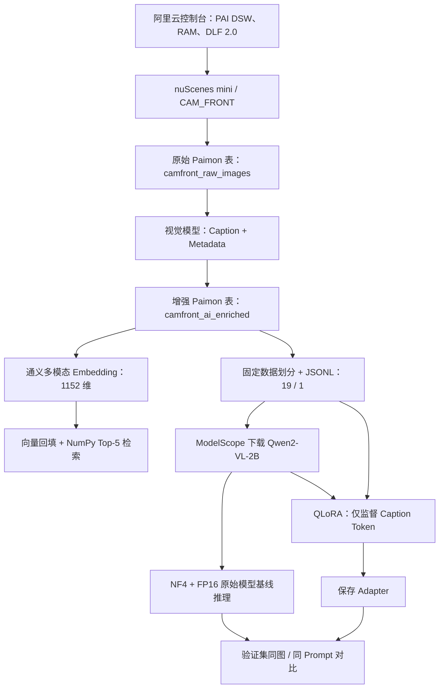
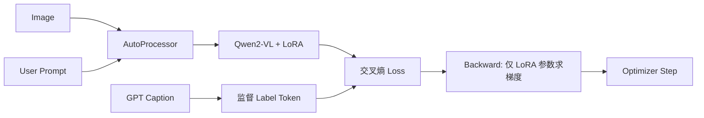

# Autonomous Driving Multimodal Pipeline

**自动驾驶图像的多模态数据处理、模型训练与推理** | nuScenes · Alibaba Cloud PAI DSW · DLF 2.0 / Paimon · Vision LLM · Multimodal Embedding · Qwen2-VL · QLoRA

这是一个面向工程实践的可复现教学项目，包含两条连续流水线：

**推荐从 Jupyter Notebook 开始：边学边运行、每一步即时查看图像、表格、Loss 和 Caption。** GitHub 可直接预览 `.ipynb` 文件；在阿里云 DSW/JupyterLab 中打开后可逐个 Cell 执行。

| Notebook 主教程 | 主要内容 | 使用方式 |
|---|---|---|
| **[01 · 自动驾驶图像多模态数据处理](notebooks/01_multimodal_data_processing.ipynb)** | nuScenes → CAM_FRONT → Paimon → Caption/Metadata → 1152 维 Embedding → Top-5 检索 | 从 Step 0 开始逐个 Cell 执行 |
| **[02 · Qwen2-VL 模型训练与推理](notebooks/02_multimodal_model_training_inference.ipynb)** | Paimon/JSONL → 19/1 划分 → NF4 模型 → Base 推理 → QLoRA → LoRA 推理对比 | 在 DSW 单卡 V100 中顺序执行 |

> **首次使用**：先完成下面第 2 节阿里云控制台配置；在 DSW Terminal 安装依赖后，**Notebook 菜单 Kernel → Restart Kernel**，再打开 Notebook 01 的 Step 1 加载 `.env`。已经有训练数据和 LoRA Adapter 的用户可以直接从 Notebook 02 开始并复用缓存。昂贵的 API、写入及训练操作默认关闭，需要显式开启。

现有的两个 Python 代码目录**保留为可复用实现**；Notebook 是交互式教程主入口，README 用于环境准备、技术说明和排错。


1. **Multimodal Data Processing of Autonomous Driving Images**：前视图像 → Paimon → Caption / Metadata → Embedding → 向量检索。
2. **Multimodal Model Training & Inference Pipeline**：Paimon → 固定训练/验证划分 → Qwen2-VL 基线推理 → QLoRA → 同图推理对比。

> **已验证范围**：2026-11-11，在阿里云 PAI DSW 的 **Tesla V100 16 GiB** 上跑通 PyTorch CUDA、Qwen2-VL-2B-Instruct NF4 量化、单卡 QLoRA 和定性推理对比；20 张 nuScenes CAM_FRONT，训练 19 张、验证 1 张。项目已包含基于既往交互实验整理的主教程 Notebook 和模块化 Python 源码；**本仓库重构版尚未在真实 DLF / DSW 全流程重新验收**。无 DLC 或 EAS 依赖，原教程中的 8 卡 DLC 与 EAS 部署属于后续扩展。

## 目录

- [1. 工作流与源码导航](#1-工作流与源码导航)
- [2. 阿里云用户准备工作（控制台操作）](#2-阿里云用户准备工作控制台操作)
- [3. DSW 环境与统一配置](#3-dsw-环境与统一配置)
- [4. Part 1：Multimodal Data Processing of Autonomous Driving Images](#4-part-1multimodal-data-processing-of-autonomous-driving-images)
- [5. Part 2：Multimodal Model Training & Inference Pipeline](#5-part-2multimodal-model-training--inference-pipeline)
- [6. 实测结果与评价边界](#6-实测结果与评价边界)
- [7. 常见错误与排查](#7-常见错误与排查)
- [8. 安全、成本、测试与参考资料](#8-安全成本测试与参考资料)

## 1. 工作流与源码导航



| 配置 / 操作 | 源码入口 |
|---|---|
| 集中配置与 `.env` | [Settings 与 Catalog 配置](config.py#L25-L90) · [.env.example](.env.example) |
| GPU / 依赖 / 云盘诊断 | [check_environment()](config.py#L94-L127) |
| 下载 nuScenes mini | [download_nuscenes.py](multimodal_data_processing/download_nuscenes.py#L15-L60) |
| 筛选 20 张相邻 CAM_FRONT | [prepare_images.py](multimodal_data_processing/prepare_images.py#L13-L60) |
| DLF Catalog 与 Paimon 写入 | [paimon_io.py](multimodal_data_processing/paimon_io.py#L10-L99) |
| GPT Caption / Metadata | [caption_metadata.py](multimodal_data_processing/caption_metadata.py#L17-L165) |
| 图像 / 文本 Embedding | [embedding.py](multimodal_data_processing/embedding.py#L16-L76) |
| 增强表与安全向量回填 | [enrichment.py](multimodal_data_processing/enrichment.py#L20-L120) |
| NumPy 余弦 Top-K | [retrieval.py](multimodal_data_processing/retrieval.py#L9-L47) |
| 样本统计、划分与 JSONL 导出 | [prepare_dataset.py](multimodal_training_inference/prepare_dataset.py#L17-L172) |
| Qwen2-VL 下载和 NF4 加载 | [model_loader.py](multimodal_training_inference/model_loader.py#L7-L65) |
| 同图原始模型推理 / Prompt | [inference.py](multimodal_training_inference/inference.py#L11-L70) |
| LoRA + Forward / Loss / Backward | [train_lora.py](multimodal_training_inference/train_lora.py#L18-L142) |
| Adapter 后处理与对比 | [evaluate.py](multimodal_training_inference/evaluate.py#L16-L58) |

项目包含 **一份总 README、两份主教程 Notebook、统一配置、两个 Python 模块和必要的依赖 / 测试文件**；所有命令从仓库根目录执行。源码和 README 使用相对链接，GitHub 上可直接跳到对应行号。

## 2. 阿里云用户准备工作（控制台操作）

### 2.1 登录、开通及区域选择

1. 在 [阿里云控制台](https://home.console.aliyun.com/) 登录，确认实名认证、支付方式以及可能的试用额度。
2. 打开 [PAI 控制台](https://pai.console.aliyun.com/)，选择 **华东 1（杭州）`cn-hangzhou`**，创建或选择工作空间。
3. 在工作空间中进入 **交互式建模（DSW）**，创建实例。实例创建页按实际支持的资源规格选择 GPU（本实验为 V100 16 GiB）。
4. 选择兼容 CUDA 的镜像 / Python 3.11 环境；配置系统云盘。把持久文件放在云盘挂载点（示例 `/mnt/systemDisk`），而不是仅依赖内存变量。
5. 启动 DSW 后进入 JupyterLab Terminal / Notebook。核对计费方式；GPU 即使空闲也可能继续收费。

> 控制台菜单文字随产品更新可能变化，关键是找到 PAI 工作空间下的 **DSW 实例管理、资源规格和存储挂载**。本仓库不自动创建付费云服务。

### 2.2 RAM 权限 / AccessKey（不要使用主账号长期密钥）

1. 在 [RAM 控制台](https://ram.console.aliyun.com/) 创建专用最小权限的身份，或按组织策略为 DSW 实例绑定 **RAM 角色**。
2. 按实际授权需求授予 DLF Catalog 的查询 / 建表 / 读写、底层 OSS 数据访问等权限；**权限应由资源管理员按 Catalog / Bucket 范围控制**，不要直接授予全部资源管理员权限。
3. 本项目验证过的 PyPaimon REST 连接使用 AccessKey 环境变量：`ALIBABA_CLOUD_ACCESS_KEY_ID` 和 `ALIBABA_CLOUD_ACCESS_KEY_SECRET`。实例 RAM 角色 / STS 的免密接入应在你当前 PyPaimon 版本验证凭证提供器后替换，不把“理论支持”写成“已验证”。
4. 将密钥存入 DSW 安全环境配置、Secrets 管理或本地未提交的 `.env`；**不要放进 Notebook 输出、GitHub、截图或 README**。有关 AK / STS：见 [RAM 官方文档](https://help.aliyun.com/zh/ram/)。

### 2.3 DLF 2.0 / Paimon 授权和 Catalog

1. 打开 [DLF 2.0 控制台](https://dlf-next.console.aliyun.com/)，确保地域与 PAI / OSS 一致（此处杭州）。
2. 创建或选择 DLF Catalog / Warehouse（示例 `vehicle_lake_demo`），创建数据库 `default` 或确认其存在。
3. 打开当前 REST Catalog 的 OpenAPI 能力；教程环境曾要求 `enable.openapi=true`。设置 Catalog 访问授权、表的建表 / 读取 / 写入权限以及后端 OSS 授权。
4. REST Endpoint 示例：`https://dlfnext.cn-hangzhou.aliyuncs.com`；OSS Endpoint 示例：`oss-cn-hangzhou.aliyuncs.com`。填入 [.env.example](.env.example)，运行 `python -m multimodal_data_processing.run check-dlf` 验证。
5. 注意：**Paimon 底层可能使用 OSS 存储并产生费用**；这里“不额外上传模型到 OSS”不等于完全不用 OSS。

源码位置：[Catalog 参数集中定义](config.py#L73-L90) 和 [连接及创建 Paimon 表](multimodal_data_processing/paimon_io.py#L10-L99)。

### 2.4 模型服务与 API 密钥

- **视觉标注**：使用支持 OpenAI Responses 图像输入的视觉模型 API；本次实操使用可配置的 OpenAI 兼容模型接口（实验模型名曾为 `gpt-6.1-sol`，部分兼容网关可能使用私有别名）。配置 `VISION_API_BASE_URL`、`VISION_API_KEY`、`VISION_MODEL`。
- **多模态 Embedding**：通义 `tongyi-embedding-vision-plus`，使用百炼 **DashScope 原生多模态 Embedding 接口**，配置 `EMBEDDING_API_URL` 和 `EMBEDDING_API_KEY`；本次结果为 1152 维。API 账号、计费与地域以百炼控制台为准。
- **训练基础模型**：`Qwen/Qwen2-VL-2B-Instruct` 从 [ModelScope 魔搭](https://modelscope.cn/models/Qwen/Qwen2-VL-2B-Instruct) 下载到 DSW 云盘；**不是把模型提交到 OSS，也不是重新预训练**。

### 2.5 GPU 与 CUDA 选型核对（本次踩坑）

| 检查项 | 最初遇到的问题 | 已验证配置 |
|---|---|---|
| DSW GPU | CPU 实例下无 GPU、`nvidia-smi unavailable` | `Tesla V100-SXM2-16GB`，单卡 |
| NVIDIA 驱动 | GPU 就绪后报告驱动 CUDA 12.8 | 驱动 570.211.01 |
| PyTorch | 错误安装 `2.15.0+cu132`，CUDA 不可用 | **2.9.1+cu126** |
| GPU 架构 | CUDA 13 构建不包含 V100 的 `sm_70` | 构建架构包含 `sm_70` |
| 加载精度 | V100 不适合 BF16 / FlashAttention-2 | FP16 + eager attention |

先运行 `nvidia-smi` 查看 GPU，然后安装**官方 CUDA 12.6 对应的 PyTorch Wheel**：

```bash
python -m pip install --no-cache-dir \
  torch==2.9.1 torchvision==0.24.1 torchaudio==2.9.1 \
  --index-url https://download.pytorch.org/whl/cu126
```

官方版本矩阵：[PyTorch Previous Versions](https://pytorch.org/get-started/previous-versions/)。不要在安装 PyPaimon 时 `--force-reinstall` 全部依赖，否则可能重新覆盖这个版本；后续使用 `constraints-v100.txt` 固定主要依赖。

## 3. DSW 环境与统一配置

### 3.1 获取源码、安装依赖

```bash
git clone https://github.com/sxxa-qlp/aliyun-autonomous-driving-multimodal-pipeline.git
cd aliyun-autonomous-driving-multimodal-pipeline
cp .env.example .env
# 使用编辑器填写最小权限密钥和 API Endpoint；不要提交 .env

# 前提：CUDA 12.6 的 torch 已按 2.5 节安装并通过 GPU 检查
python -m pip install -r requirements-data.txt -c constraints-v100.txt
python -m pip install -r requirements-train.txt -c constraints-v100.txt
python -m pip check
```

**安装依赖后：重启 DSW/JupyterLab 的 Python Kernel。** 在 Notebook 菜单选择 **Kernel → Restart Kernel**（或工具栏的重启按钮）。这不是终端命令；重启仅清空当前 Notebook 的 Python 变量，不会删除云盘上的 `.env`、数据集、模型缓存或 LoRA 权重。安装依赖是在 Terminal 中执行的，重启 Kernel 是为了让 Notebook 使用更新后的 Python 环境。

**重启完成后，再加载参数并检查环境：**

在项目目录下的 **Terminal** 执行：

```bash
python config.py --check
```

如果需要在 **Notebook** 中继续使用配置，确保 Notebook 工作目录为项目根目录，然后执行一个新 Cell：

```python
from config import settings, check_environment

check_environment()             # 检查环境变量是否已从 .env 加载
print("DLF Warehouse:", settings.dlf_warehouse)
print("模型目录:", settings.model_cache_dir)
# 不要输出 AccessKey Secret / API Key
```

- 本项目使用的已验证 Python 是 **3.11.14**。依赖基线 `pypaimon==1.4.2`、`transformers==4.52.4`、`peft==0.15.2`、`bitsandbytes==0.48.0`。PyPaimon 2.x 可能有 API 变化，此项目暂不声称兼容。
- `requirements-data.txt` 与 `requirements-train.txt` 分开方便只运行数据处理或训练。`constraints-v100.txt` 是版本约束，**不会自动选择 CUDA Wheel 下载源**；请先执行上面 PyTorch 专用安装命令。
- **先安装依赖，再重启 Notebook Kernel，最后加载配置**：Terminal 的独立 Python 命令本身不依赖 Notebook Kernel，但 Notebook 必须重新导入模块才会使用新环境与新变量。
- `python config.py --check` **仅执行只读的环境测试**，会显示缺失项但不会打印密钥原文。[环境检查源码](config.py#L94-L127)。

### 3.2 一处配置，两个模块复用

- 所有可编辑配置都在 [.env.example](.env.example) 和 [config.py](config.py#L25-L90)。
- 其他脚本通过 `from config import settings` 获取环境变量。例如 Catalog 使用 `settings.catalog_options()`，数据集路径使用 `settings.dataset_dir`。
- 默认 `WORK_DIR=/mnt/systemDisk/ad_multimodal`；模型缓存默认 `/mnt/systemDisk/model_cache`。这些是 **DSW 挂载云盘路径**，不是本地电脑路径，也不会自动成为 DLC / EAS 的数据挂载路径。
- `.env` 在 `.gitignore` 中排除；命令行使用可配置参数，不把密钥、OSS 签名或模型缓存写回 Git 仓库。

### 3.3 Notebook：按 Cell 加载 Python 配置

```python
from config import settings, check_environment
check_environment()
print(settings.raw_table, settings.enriched_table)
# 绝对不要 print(settings.access_key_secret)！
```

**优先使用上面的两个 Notebook 学习和实验**，需要批量自动化时再使用终端 `python -m ...`。模型缓存不会因为 Kernel 重启消失，但 `model`、`processor`、`train_records` 等变量会消失。重新运行对应脚本即可恢复。

## 4. Part 1：Multimodal Data Processing of Autonomous Driving Images

### 4.1 下载 nuScenes mini 并选取 CAM_FRONT

本次实操使用官方 [nuScenes](https://www.nuscenes.org/) mini 数据中的前视图像。请先阅读数据集许可和访问条款，**不要把原始图片重新发布到 GitHub**。

```bash
python -m multimodal_data_processing.download_nuscenes --accept-dataset-terms
python -m multimodal_data_processing.prepare_images --source sweeps --limit 20
```

- 下载的 tar.gz、解压图像保存在 `WORK_DIR`，默认被 Git 忽略。
- 优先选择同一相机日志下按时间戳排序的连续 20 帧，尽量避免跨日志混合。若下载包只有 `samples/CAM_FRONT`，改用 `--source samples`；若样本不足 20 张，必须调整数据源，不能静默混合日志。
- 对图片执行 Pillow 检查，再以二进制写入 Paimon。源码：[下载 / 安全解压](multimodal_data_processing/download_nuscenes.py#L15-L60)、[时间序列选图](multimodal_data_processing/prepare_images.py#L13-L60)。

### 4.2 创建并验证原始 Paimon 表

```bash
python -m multimodal_data_processing.run check-dlf
python -m multimodal_data_processing.run raw --source sweeps --limit 20
```

目标：`default.camfront_raw_images`，核心字段：`fileName STRING`、`picture BINARY`。使用 REST Catalog 和 Arrow 写入，通过 `prepare_commit()` / `commit()` 发布快照后，再重新读取核验。

源码：[表 Schema / 建表 / 事务写入 / 重复检查](multimodal_data_processing/paimon_io.py#L10-L99)。当前表是 **Parquet append-only、无主键**，如果已有记录自动跳过 Append，以免重复写入。请不要把它与原教程 Spark + Lance 主键表混为一谈。

### 4.3 Caption 与 Metadata：视觉大模型标注

```bash
python -m multimodal_data_processing.run caption --limit 20
```

对 20 张图像逐一构造 JPEG data URL，调用视觉 API 的 Responses 图像输入，解析严格 JSON，包含 `caption`、`weather`、`lighting`、`road_type`、`scene_type`、`objects`、`risks`、白天/阴天等标签。每成功一条就存 CSV 到本地，支持已完成图片跳过，防止重复支付 API 费用。记录是模型生成的**伪标签**，不是人工核验的 Ground Truth。

源码：[Prompt、图像编码、Responses 调用、JSON 校验、断点续跑](multimodal_data_processing/caption_metadata.py#L17-L165)。

### 4.4 生成增强表 / 回填向量

```bash
# 把图片、Caption、Metadata 合成增强 Paimon 表，vector 先留空
python -m multimodal_data_processing.run enrich

# 谨慎操作：先本地备份再整表 overwrite；会真实调用收费 Embedding API
python -m multimodal_data_processing.run embedding --confirm-overwrite
```

目标：`default.camfront_ai_enriched`。字段包括 `id`、`fileName`、`picture`、`caption`、`metadata`、`vector`、`weather`、`lighting`、`road_type`、`scene_type`、`dataset_tag=1` 等。

- 图片向量使用 `tongyi-embedding-vision-plus`，本次实测 **1152 维**。文本查询需要同一个多模态模型输出的文本向量，不是把 Caption 和图片合成单条向量。
- 图像向量按原始图片 SHA-256 缓存为 `.npy`，API 中断可续跑。只有长度和数值合法的向量能写入。
- **为什么整表 overwrite？** 当前 Paimon 表无主键、无分区、append-only，直接 Append 不能按 ID 更新 `vector`。回填前备份为 Parquet，确认完整向量后再整体覆盖；运行时不得有其他并发写入者。见 [安全回填代码](multimodal_data_processing/enrichment.py#L20-L120)。

### 4.5 NumPy 检索：以文搜图 / 以图搜图

```bash
python -m multimodal_data_processing.retrieval --text "cloudy city intersection with pedestrians" --top-k 5
python -m multimodal_data_processing.retrieval --image-index 0 --top-k 5
```

先 L2 归一化数据库图像向量与查询向量，再计算余弦相似度：

\[s_i = \frac{q^T v_i}{\|q\|_2\,\|v_i\|_2}\]

输出 Top-5 文件名、Score、Caption。**这里只是 20 张图像的 NumPy 全量检索**，没有实现 Faiss / Milvus / ANN 索引。源码：[cosine_topk()](multimodal_data_processing/retrieval.py#L9-L47)。

## 5. Part 2：Multimodal Model Training & Inference Pipeline

### 5.1 从增强 Paimon 导出训练 / 验证集

```bash
python -m multimodal_training_inference.prepare_dataset
```

- 过滤 `dataset_tag == 1`、图片和 Caption 非空，拒绝重复 `id` / `fileName`。
- 数据按 ID 排序后，`seed=20260520` 随机打乱，划分 `95% / 5%`，20 条时得到 **训练 19 / 验证 1**。
- 实际保存 `split_manifest.json`，明确 train/validation IDs；**不能仅靠随机种子来保证 DLC、DSW 或不同 DataFrame 顺序得到完全相同验证集**。
- 导出 `images/*.jpg`、`train.jsonl`、`validation.jsonl`，并输出训练集 Caption 字符数及图片 KB 大小统计（对应原教程 *Training Dataset Statistics Overview*）。[完整源码](multimodal_training_inference/prepare_dataset.py#L17-L172)。

> **已有旧版 JSONL？** 如果你已经生成 `/mnt/systemDisk/ad_multimodal/vlm_training/{train,validation}.jsonl` 和 `baseline_prediction.json`，**不必重新划分**：运行 `python -m multimodal_training_inference.prepare_dataset --verify-existing`，只验证旧数据并补充 `split_manifest.json`，不会改动任何图片或 Caption。普通重划分会保护旧 JSONL，避免静默覆盖。如果希望重新划分，设置新的 `WORK_DIR=/mnt/systemDisk/ad_multimodal_repo`，并重新生成基线。

### 5.2 加载 Qwen2-VL 基础模型（NF4 + FP16）

```bash
python -m multimodal_training_inference.model_loader
```

从 ModelScope 复用缓存/下载 `Qwen/Qwen2-VL-2B-Instruct`，使用 `AutoProcessor.from_pretrained()` 加载输入处理规则，并用 `Qwen2VLForConditionalGeneration.from_pretrained()` 加载**已预训练的模型权重**。二者都不是执行预训练。源码：[model_loader.py](multimodal_training_inference/model_loader.py#L7-L65)。

| 概念 | 本仓库配置 / 解释 |
|---|---|
| FP16 | 16 位浮点计算；V100 原生支持 |
| BF16 | Brain Floating Point 16；不使用，V100 无原生 BF16 Tensor Core |
| NF4 | NormalFloat 4；基础权重 4-bit 量化存储，计算用 FP16 |
| `image_grid_thw` | Qwen2-VL 视觉网格信息，告诉模型视觉 Token 的时/高/宽分布 |
| `min_pixels` / `max_pixels` | 约束图像预处理分辨率，实际视觉 Token 数随图像比例和对齐规则变化 |
| `attn_implementation="eager"` | 优先兼容 V100，不强制 FlashAttention-2 |

本次原始 Notebook 模型加载后 `torch.cuda.memory_allocated()` 曾显示约 **1.42 GiB**，**不是训练峰值显存**。

### 5.3 保存基础模型的预测（Baseline）

```bash
python -m multimodal_training_inference.inference
```

固定英文 Prompt：描述道路布局、交通参与者、天气、可见风险，要求 1–2 句英文且不使用列表。验证集图片经 Processor 转成 `input_ids`、`attention_mask`、`pixel_values`、`image_grid_thw`，送入 `model.generate(max_new_tokens=128, do_sample=False)`。

预测和 Prompt、图片 ID、生成参数一起保存为 `baseline_prediction.json`，避免后续重启 Kernel 后丢失。源码：[inference.py](multimodal_training_inference/inference.py#L11-L70)。

### 5.4 微调：挂载 LoRA，单样本 Forward / Loss / Backward

```bash
# 可选：只运行一次 optimizer step，做完整链路 smoke test
python -m multimodal_training_inference.train_lora --max-optimizer-steps 1 \
  --output-dir /mnt/systemDisk/ad_multimodal/qlora_smoke_test

# 正式小样本复现：19 张，1 Epoch，梯度累积 4 次
python -m multimodal_training_inference.train_lora \
  --epochs 1 --accumulation 4 --learning-rate 1e-4
```

**注意：Smoke test 会更新并保存它自己的 Adapter；正式训练会从基础模型重新加载，并保存到另一个输出目录。** 如果默认路径已包含 `adapter_config.json`，训练脚本会拒绝覆盖，请使用新的 `--output-dir`。

原理如下：



- **只挂载一次**：在 `q_proj / k_proj / v_proj / o_proj` 上使用 LoRA (`r=8, alpha=16, dropout=0.05`)，冻结基础模型参数，避免重复执行 `get_peft_model()` 造成多个 Adapter。
- **Teacher Forcing**：完整输入是 `User(Image + Prompt)` 与 `Assistant(参考 Caption)`。前缀 `labels=-100`，交叉熵仅监督 Assistant 答案 Token。
- **优化**：FP16 计算，AdamW，1 个 Epoch，19 张图片，4 个样本梯度累积成一次更新，共 **5 次 optimizer step**（最后 3 个样本也更新）。
- **持久化**：保存 LoRA Adapter、Processor、`train_summary.json`、`loss_curve.png`，不提交这些产物到 Git。

源码入口：[attach_lora_once() / encode_training_sample() / train()](multimodal_training_inference/train_lora.py#L18-L142)。

### 5.5 微调后在同一张验证图片上推理

```bash
python -m multimodal_training_inference.evaluate
```

从本地重新加载 4-bit 基础模型，使用 `PeftModel.from_pretrained()` 挂载保存的 LoRA Adapter；严格检查 **验证图像 ID、参考 Caption、相同 Prompt、相同预处理 token 上限及 `max_new_tokens=128, do_sample=False`**。生成新的 Caption 后保存 `inference_comparison.json`。源码：[evaluate.py](multimodal_training_inference/evaluate.py#L16-L58)。

> 如果使用旧版 Notebook 导出的 `baseline_prediction.json`，其中可能没有 `image_id`、预处理限制等元数据。本仓库只对旧格式进行有限兼容，严格复现建议重新运行 5.3 生成新格式基线；不要用不同图片或不同 Prompt 进行比较。

## 6. 实测结果与评价边界

以下为之前在 **DSW V100 + PyTorch 2.9.1+cu126 + Qwen2-VL-2B** 上完成的真实交互式实验记录（不是本仓库源码的自动 CI 结果）。

| 项目 | 结果 |
|---|---|
| 图像 | nuScenes CAM_FRONT 连续帧 20 张 |
| 样本划分 | 19 train / 1 validation |
| 图像 Embedding | 通义 1152 维 |
| 训练 | QLoRA NF4 / FP16，1 Epoch |
| LoRA 可训练参数 | **2,179,072 / 2,211,164,672（0.0985%）** |
| 微调前输出 | 7 项英文列表，最后一项被 128 Token 限制截断 |
| 微调后输出 | 简洁的单句英文道路场景描述 |

**GPT 参考伪标签：**

> A city street approaches a signalized intersection with marked crosswalks, cars ahead, and pedestrians on both sidewalks. Multi-story brick buildings line the road under a cloudy daytime sky.

**微调后的 Qwen2-VL：**

> A busy urban street with brick buildings on both sides, traffic lights, pedestrians, and vehicles, with a cloudy sky overhead.

效果表明：输出形式从冗长分点列表转向简洁 Caption。但后者仍未提及信号化路口的人行横道；**不能单凭 1 张近邻验证图片断言视觉语义能力或泛化能力提升**。要做严谨评估，应按 nuScenes Scene 分离训练/测试，扩充白天、雨天、夜间、高速等异质样本，并使用人工审查或适当评估指标。

## 7. 常见错误与排查

| 症状 | 原因 / 处理方式 |
|---|---|
| `torch.cuda.is_available() == False` | 先查 DSW 是否分配 NVIDIA GPU，再运行 `nvidia-smi`。CUDA 构建版本、驱动、架构均需兼容。 |
| `sm_70` 不在 PyTorch arch list | V100 不适用缺少 Volta 支持的 CUDA 13 构建；按第 2.5 节恢复 CUDA 12.6 PyTorch。 |
| 安装 PyPaimon 后 GPU 失效 | 依赖解析覆盖了 PyTorch；检查 `pip check` 与 `torch.__version__`，不要用 `--force-reinstall` 全量重装。 |
| `ModuleNotFoundError: transformers` | 安装 `requirements-train.txt`，Notebook 重启 Kernel 后重新导入。 |
| `ModuleNotFoundError: matplotlib` | 安装绘图依赖；训练 Loss 同时保存 JSON，绘图并非运行训练的前提。 |
| `NameError: inputs / model / MODEL_DIR` | Jupyter Kernel 重启清空变量，重新执行初始化。运行 Python 模块可减少变量依赖。 |
| `train.jsonl` 找不到 | 目录实际为 `/mnt/systemDisk/ad_multimodal/vlm_training`，不是 `/root/ad_multimodal/vlm_training` 或 `dlc_dataset`。 |
| PEFT `modify a model ... for a second time` | 重复执行 `get_peft_model()`；重新加载基础模型，只挂载一次。 |
| `temperature / top_p / top_k` 无效警告 | `do_sample=False` 使用确定性解码，存量 generation config 的采样参数被忽略；非致命。 |
| `slow image processor` / `video_preprocessor.json` 告警 | Transformers 的兼容 / 弃用提示，本次静态图片示例使用 `use_fast=False`；非致命。 |
| GPU Out of Memory | 优先降低 `IMAGE_MAX_TOKENS`（例如 128），重新加载模型；batch size 维持 1。 |
| Paimon 出现重复行 | 当前无主键 Append 表，不能用 Append 做 UPDATE；先人工核查表数据、备份后再选择修复。 |
| 验证集改变 | 固定 manifest；不要覆盖旧 JSONL + baseline，改新输出目录。 |

## 8. 安全、成本、测试与参考资料

### 安全与费用

- `.env`、原始图像、模型文件、Adapter、Checkpoint、缓存和数据快照全部忽略提交。不要在 GitHub Issues 粘贴 API Key、含凭证的 HTTP 请求或云端控制台截图。
- 数据处理和模型推理均可能调用计费 API：DSW GPU 和云盘、DLF 及其底层 OSS、视觉 Caption、百炼 Embedding 等。即使不使用额外 OSS 模型副本，也可能存在 **Paimon 的 OSS 存储费用**。
- 原教程将 Qwen2-VL 模型上传 OSS 并挂载给 8 卡 DLC；本工程采用单卡 DSW 训练，**不使用 DLC / EAS**，以减少重复存储与在线部署成本。GPU 停止计费与云盘持久性需参照具体 DSW 资源规格。
- 本仓库不包含 nuScenes 原始图片、含版权的模型权重或任何个人账号凭证；数据集和模型使用遵循原发布方许可。

### 测试

```bash
python -m compileall -q config.py multimodal_data_processing multimodal_training_inference tests
python -m unittest discover -s tests -v
python -m pip check
```

CPU 单元测试覆盖 19/1 固定划分、数据损坏检测、JSONL 复用、结构化 Caption、Metadata、向量 Top-K。**GPU 推理、真实 Paimon IO、收费 API 不会由 CI 自动调用**；需要在 DSW 按第 4～5 章手工验收。

### 资料与技术来源

- [nuScenes 官网](https://www.nuscenes.org/)
- [阿里云 PAI](https://pai.console.aliyun.com/) / [DLF 2.0](https://dlf-next.console.aliyun.com/)
- [Apache Paimon PyPaimon Quick Start](https://paimon.apache.org/docs/master/pypaimon/quick-start/) 与 [Batch Writes](https://paimon.apache.org/docs/master/pypaimon/writing/)
- [PyTorch 官方 CUDA 历史版本](https://pytorch.org/get-started/previous-versions/)
- [Qwen2-VL-2B-Instruct — ModelScope](https://modelscope.cn/models/Qwen/Qwen2-VL-2B-Instruct)
- [Qwen2-VL-2B-Instruct — Hugging Face](https://huggingface.co/Qwen/Qwen2-VL-2B-Instruct)
- [Hugging Face bitsandbytes 量化文档](https://huggingface.co/docs/transformers/quantization/bitsandbytes)

### License / License note

源码可根据仓库维护者选择的许可证开放；nuScenes 数据与预训练模型需分别遵循其原许可。**本仓库不包含原始图像和模型权重。**