# 阿里云 PAI 平台自动驾驶数据处理、训练与推理实践

## 背景介绍

选择阿里云的PAI平台学习，是因为我是阿里云ECS的重度用户，感觉aliyun平台的易用性和生态丰富性以及模型方面相比腾讯、华为、京东云都好太多了（毕竟aliyun对标的AWS）。

两个官方教程包括：

- 学习并熟悉自动驾驶图像的多模态数据处理pipeline 

  **Multimodal Data Processing of Autonomous Driving Images**：前视图像 → Paimon → Caption / Metadata → Embedding → 向量检索。
- 学习并熟悉多模态数据下的模型训练与推理

  **Multimodal Model Training & Inference Pipeline**：Paimon → 固定训练/验证划分 → Qwen2-VL 基线推理 → QLoRA → 同图推理对比。

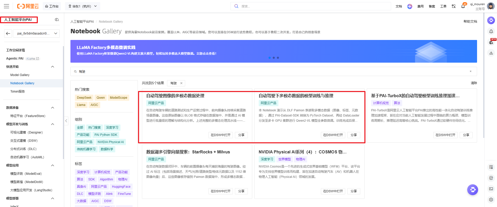

注意：

1. **第二个教程要在第一个完成的基础上进行**，否则会因为没有Paimon数据表导致无法训练。
2. 数据处理教程的目的是创建一个Paimon来描述多模态数据，包括：
   1. Caption（场景描述）
   2. Metadata（场景结构化描述JSON data）
   3. embedding（图片经过embedding模型返回来的高维特征向量）

   教程中获取这个多模态数据需要用到DataWorks+Livy Gateway+EMR访问DLF/Paimon，这些是阿里云数据中台的架构【TODO：留个坑，有时间去研究下这个架构】，通过DataWorks平台利用Livy Gateway接口提交计算任务给EMR计算引擎，EMR会访问指定OSS或者DLF/Paimon的数据。好处是EMR内嵌了AI Function可以方便的通过接口获得Caption + Metadata + embedding。

   但缺点也很明显，这套“屠龙技”对于这个教程实在是杀鸡用牛刀了，毕竟我们重点也不在这个地方。所以我们通过如下方法获取：

   1. caption + metadata：调用第三方视觉模型处理图片，比如“gpt-6.1-sol”
   2. embedding：调用tongyi-embedding-vision-plus模型返回向量

> **已验证范围**：2026-11-11，在阿里云 PAI DSW 的 **NVIDIA A10 24GB** 上跑通 PyTorch CUDA、Qwen2-VL-2B-Instruct NF4 量化、单卡 QLoRA 和定性推理对比；20 张 nuScenes CAM\_FRONT，训练 19 张、验证 1 张。TODO：后面尝试用DLC做多卡训练。

**关键词**：nuScenes · Alibaba Cloud PAI DSW · DLF 2.0 / Paimon · Vision LLM · Multimodal Embedding · Qwen2-VL · QLoRA

## 目录

- [背景介绍](#背景介绍)
- [0. 准备工作](#0准备工作)
- [1. 工作流与源码导航](#1-工作流与源码导航)
- [2. 阿里云用户准备工作（控制台操作）](#2-阿里云用户准备工作控制台操作)
- [3. Part 1：多模态数据处理（Step 0–10）](#3-part-1multimodal-data-processing-of-autonomous-driving-images)
- [4. Part 2：多模态模型训练与推理](#4-part-2multimodal-model-training--inference-pipeline)
- [5. 实测结果与评价边界](#5-实测结果与评价边界)
- [6. 常见错误与排查](#6-常见错误与排查)
- [7. 安全、成本、测试与参考资料](#7-安全成本测试与参考资料)

## 0.准备工作

### 1.创建DSW

1. 在 [阿里云控制台](https://home.console.aliyun.com/) 登录。
2. 打开 [PAI 控制台](https://pai.console.aliyun.com/)，选择 **华东 1（杭州）**`cn-hangzhou`，创建或选择工作空间。
3. 在工作空间中进入 **交互式建模（DSW）**，创建实例。
4. 选择兼容 CUDA 的镜像 / Python 3.11 环境；配置系统云盘。

目前的活动是aliyun PAI平台连续三个月，每月送250计算时，合计750cu。这个计算时是用来租DSW机器的计费单位，比如750cu大致可使用**ecs.gn7i-c8g1.2xlarge**，即**8c30g A10-24g**独显的DSW机器约107h，优先选这个配置的机器，因为独显高且消耗额度少，而且支持FP16 BF16 TF32,相比V100多支持后者，因为A系列是SM8.6 CUDA，GPU的架构大升级。

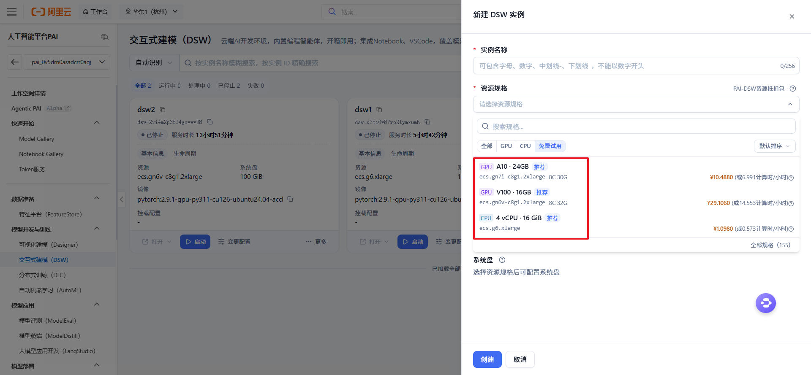

选择不同GPU型号，可选的镜像已经是筛选之后的，也就是GPU的驱动和CUDA肯定是兼容的。我们只用选择项目要求的PyTorch、CUDA、py版本对应的镜像就好了，很省心。比如：pytorch:2.9.1-gpu-py311-cu126-ubuntu24.04-accl。【TODO：留个坑，后面写一个PyTorch CUDA GPU driver的兼容链文档】

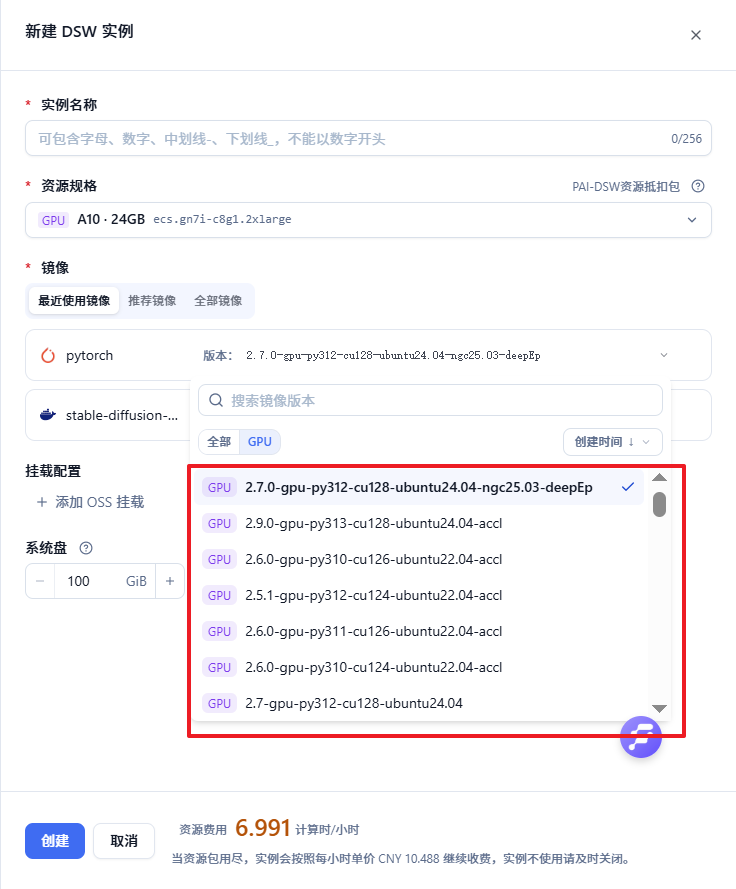

**试用领取、额度查询**

[https://help.aliyun.com/zh/pai/product-overview/free-trial-guide?spm=5176.28197619.console-basesearch-panel.dtab-help2858359.32e73ae4VF7uOc&scm=20140722.Shelp%40%40文档%40%402858359.SBB2%40bl%2BRQW%40ag0%2BBB1%40ag0%2Bos0.ID2858359-RLDSW免费试用-LOCconsoleUNDhelp-ORser-PAR10a06dfe517945600336778720e47ba-V4-P00-P10](https://help.aliyun.com/zh/pai/product-overview/free-trial-guide?spm=5176.28197619.console-base_search-panel.dtab-help_2858359.32e73ae4VF7uOc&scm=20140722.S_help%40%40%E6%96%87%E6%A1%A3%40%402858359.S_BB2%40bl%2BRQW%40ag0%2BBB1%40ag0%2Bos0.ID_2858359-RL_DSW%E5%85%8D%E8%B4%B9%E8%AF%95%E7%94%A8-LOC_console~UND~help-OR_ser-PAR1_0a06dfe517945600336778720e47ba-V_4-P0_0-P1_0)

**估算大模型所需显存**

[https://help.aliyun.com/zh/pai/product-overview/estimation-of-the-required-video-memory-for-the-model?spm=a2c4g.11186623.help-menu-30347.d012.648d4c4bCXymYa](https://help.aliyun.com/zh/pai/product-overview/estimation-of-the-required-video-memory-for-the-model?spm=a2c4g.11186623.help-menu-30347.d_0_1_2.648d4c4bCXymYa)

**领取EMR试用链接**

[https://free.aliyun.com/?utmsource=chatgpt.com&searchKey=EMR](https://free.aliyun.com/?utm_source=chatgpt.com&searchKey=EMR)

### 2.RAM给DLF授权

1. 在 [RAM 控制台](https://ram.console.aliyun.com/) 给 **RAM 角色授权DLF（Data Lake Formation），ID和Key只在创建的时候显示一次，需要留存，在DSW里访问DLF的时候会用到**。

   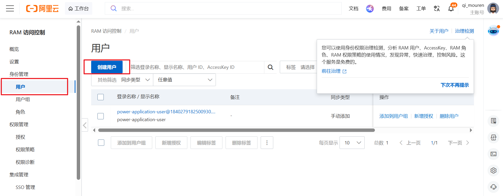

     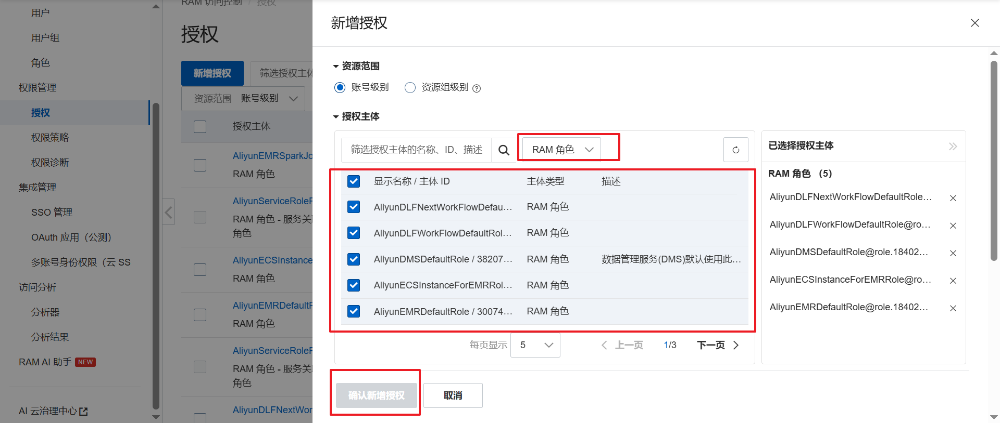
2. 回到DLF首页同步RAM授权，注意地域要确认和DSW区域一致。我的DSW在杭州1，这里用上海1演示。

   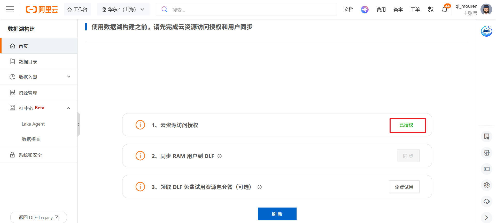

     创建DLF catalogs

     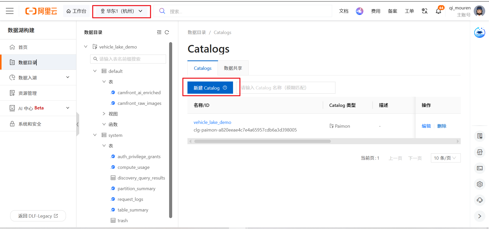

     对这个DLF数据目录里面的Paimon表授权读写操作

     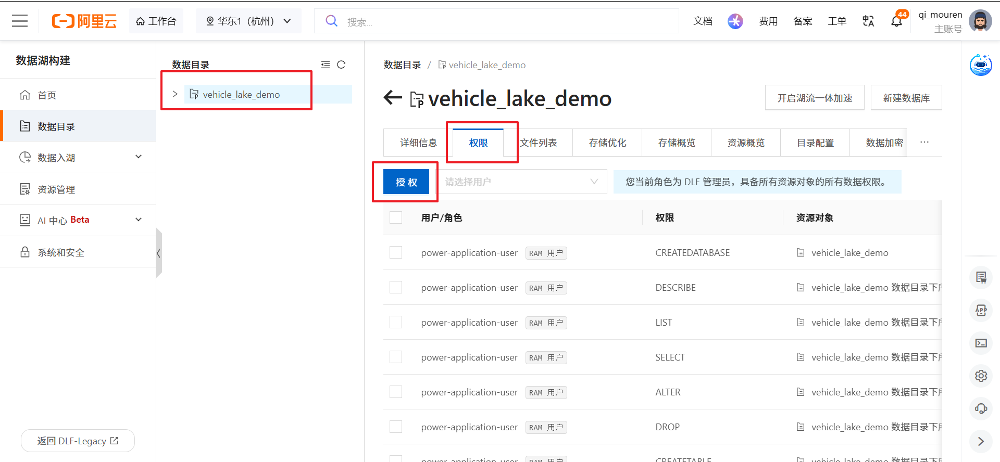

     读写操作要分别授权，因为会从这里读原始图，会写入多模态的数据

     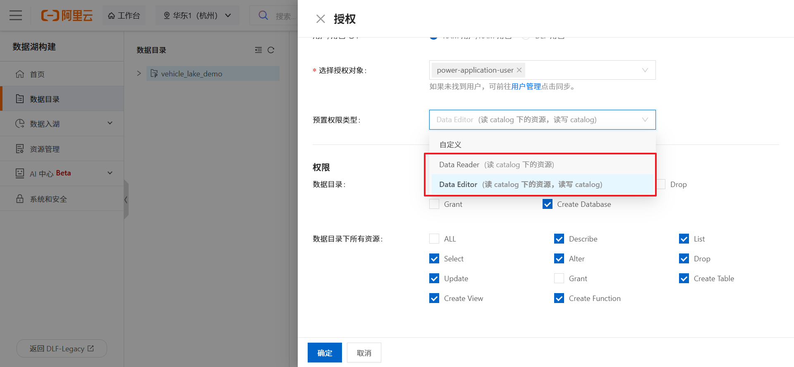

### 3.准备模型密钥

1. **视觉标注**：使用支持 OpenAI Responses 图像输入的视觉模型 API，比如gpt-6.1-sol
2. **多模态 Embedding**：通义 `tongyi-embedding-vision-plus`，使用百炼 **DashScope 原生多模态 Embedding 接口**，配置 `EMBEDDING_API_URL` 和 `EMBEDDING_API_KEY`；本次结果为 1152 维。注意，这里必须使用百炼提供的 **DashScope 接口**，[官方](https://docs.bailian.console.aliyun.com/zh/model-studio/embedding#:~:text=%E5%A4%9A%E6%A8%A1%E6%80%81%E7%8B%AC%E7%AB%8B%E5%90%91%E9%87%8F%E5%8C%96%E5%8A%9F%E8%83%BD%E9%9C%80%E8%A6%81%E9%80%9A%E8%BF%87%20DashScope%20SDK%20%E6%88%96%20API%20%E6%9D%A5%E8%B0%83%E7%94%A8%EF%BC%8C%E4%B8%8D%E6%94%AF%E6%8C%81%20OpenAI%20%E5%85%BC%E5%AE%B9%E6%8E%A5%E5%8F%A3%E8%B0%83%E7%94%A8%E6%88%96%E5%9C%A8%E6%8E%A7%E5%88%B6%E5%8F%B0%E7%9B%B4%E6%8E%A5%E4%BD%BF%E7%94%A8%E3%80%82)文档说了这里不支持OpenAI兼容URL。

   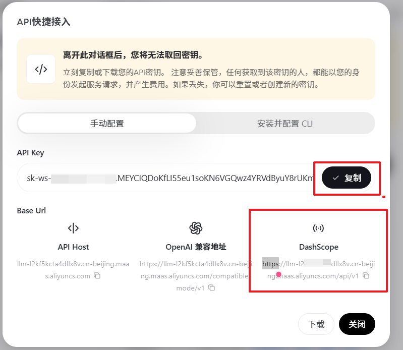
3. **训练基础模型**：`Qwen/Qwen2-VL-2B-Instruct` 从 [ModelScope 魔搭](https://modelscope.cn/models/Qwen/Qwen2-VL-2B-Instruct) 下载到 DSW 云盘，**跳转对应的代码**

## 1. 工作流与源码导航

| Notebook | 内容 | 运行环境 |
|---|---|---|
| **[01 · Multimodal Data Processing of Autonomous Driving Images](notebooks/01_multimodal_data_processing.ipynb)** | 下载 / 选择 nuScenes CAM_FRONT → 创建原始 Paimon 表 → GPT Caption/Metadata → 增强表 → 1152-d Embedding → Top-5 图文检索 | 阿里云 DSW，Python 3.11 |
| **[02 · Multimodal Model Training & Inference Pipeline](notebooks/02_multimodal_model_training_inference.ipynb)** | 数据导出 / 19:1 划分 → Qwen2-VL-2B 基线推理 → NF4 + FP16 → QLoRA → Loss / LoRA Adapter → 同图 Caption 对比 | DSW **A10 24G**（本次验证） |

**推荐操作**：在 DSW JupyterLab 左侧文件浏览器中打开对应 `.ipynb`，从 Step 0 开始按顺序执行。Notebook 会逐步解释需要的环境、输入、实际调用和结果，不需要运行额外 `.py` 业务脚本。首次运行请先完成后面 2–3 节。

```text
aliyun-autonomous-driving-multimodal-pipeline/
├── README.md
├── .env.example              # 环境变量模板；实际密钥写 .env，不上传
├── .gitignore
├── requirements-data.txt
├── requirements-train.txt
├── constraints-cu126.txt
└── notebooks/
    ├── 01_multimodal_data_processing.ipynb
    └── 02_multimodal_model_training_inference.ipynb
```

## 2. 阿里云用户准备工作（控制台操作）

以下操作是在**阿里云控制台**完成的，区别于后续 DSW Notebook 中运行的代码。

| 步骤 | 在控制台要做的事情 | 实验说明 |
|---|---|---|
| 2.1 PAI / DSW | 开通 PAI，创建 Workspace 和 DSW 实例，选择支持的地域、云盘 | 本次使用 `cn-hangzhou`，数据与模型缓存放持久云盘 |
| 2.2 GPU 规格 | 选择 GPU 实例并查看可用规格和成本 | 已实测 **NVIDIA A10 24GB** 显卡 |
| 2.3 RAM 身份 | 创建最小权限 RAM 用户/角色并授权 DLF/OSS 访问 | 长期 AK：ID+Secret |
| 2.4 DLF 2.0 | 开通 **DLF 2.0**，创建 REST Catalog、Database、Warehouse，授予建表/读写权限 | 例：`vehicle_lake_demo`，`default` 数据库|
| 2.5 视觉模型 | 准备支持 OpenAI **Responses API**（图片输入）的接口和模型名 | 可使用你有权限的视觉模型服务；本项目不附带付费账号 |
| 2.6 通义 Embedding | 在百炼开通多模态 Embedding，获取 DashScope API Key / Endpoint | 本实验使用 `tongyi-embedding-vision-plus`，图片/文本统一输出 **1152 维** |

云端入口：[PAI](https://pai.console.aliyun.com/) · [DLF 2.0](https://dlf-next.console.aliyun.com/) · [RAM](https://ram.console.aliyun.com/) · [百炼](https://bailian.console.aliyun.com/)。控制台页面、资源与计费可能随地域及账号权限变化。

**原教程与本仓库的差异**：原阿里云案例包含 EMR Serverless Spark、DLC 多卡训练和 EAS 部署。为了降低成本，我们实际走通的是 **DSW + PyPaimon REST + OpenAI 兼容视觉 API + 百炼 Embedding + DSW 单卡 QLoRA**。

## 3. Part 1：Multimodal Data Processing of Autonomous Driving Images

### Step 0 · 获取源码、安装依赖、参数配置

[Notebook 01 - Step 0](notebooks/01_multimodal_data_processing.ipynb#step-0--dsw-安装依赖--重启-kernel先在-terminal-完成)

参数配置

***这些变量在.env里面填写***

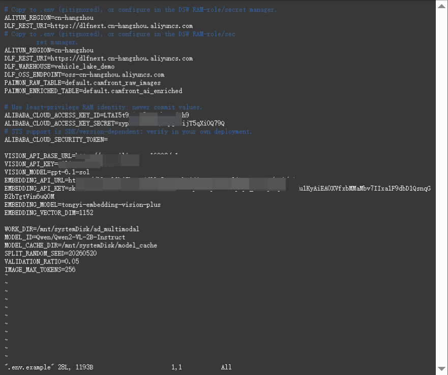

| 变量                                | 值                                                                                                                                        |
| --------------------------------- | ---------------------------------------------------------------------------------------------------------------------------------------- |
| `ALIBABA_CLOUD_ACCESS_KEY_ID`     | 【必填】填写你自己的 RAM AccessKey ID。                                                                                                             |
| `ALIBABA_CLOUD_ACCESS_KEY_SECRET` | 【必填】填写你自己的 RAM AccessKey Secret。                                                                                                         |
| `VISION_API_BASE_URL`             | 【必填】填写视觉标注服务的 API Base URL。                                                                                                              |
| `VISION_API_KEY`                  | 【必填】填写视觉标注服务的 API 密钥。                                                                                                                    |
| `EMBEDDING_API_KEY`               | 【必填】填写对应 Embedding 服务的 API 密钥。                                                                                                           |
| `VISION_MODEL`                    | 【指定使用值】`gpt-6.1-sol`，用于 Caption / Metadata。模板原值为 `your-vision-model`，需要在 `.env` 中修改。                                                     |
| `EMBEDDING_API_URL`               | 【指定使用值】`https://YOUR_BAILIAN_ENDPOINT.cn-beijing.maas.aliyuncs.com/api/v1/services/embeddings/multimodal-embedding/multimodal-embedding` |
| `USE_FULL_MINI`                   | 【默认】`false` `false`：20 张图片跑流程。 `true`：全部 mini CAM\_FRONT 图片。                                                                               |
| `ALIYUN_REGION`                   | 【默认】`cn-hangzhou`，与实际 DLF 服务地域一致。                                                                                                        |
| `DLF_REST_URI`                    | 【默认】`https://dlfnext.cn-hangzhou.aliyuncs.com`                                                                                           |
| `DLF_WAREHOUSE`                   | 【默认】`vehicle_lake_demo`，如与你创建的 Warehouse 不同则修改。                                                                                          |
| `DLF_OSS_ENDPOINT`                | 【默认】`oss-cn-hangzhou.aliyuncs.com`，按实际 OSS 配置确认。                                                                                         |
| `ALIBABA_CLOUD_SECURITY_TOKEN`    | 【默认】留空；长期 RAM AccessKey 无需填写。使用 STS 临时凭证时需填写配套 Token。                                                                                    |
| `PAIMON_RAW_TABLE`                | 【默认】`default.camfront_raw_images` 全量模式自动追加 `_full_mini` 后缀，已有该后缀时不重复追加。                                                                  |
| `PAIMON_ENRICHED_TABLE`           | 【默认】`default.camfront_ai_enriched` 全量模式自动追加 `_full_mini` 后缀，已有该后缀时不重复追加。                                                                 |
| `EMBEDDING_MODEL`                 | 【默认】`tongyi-embedding-vision-plus`                                                                                                       |
| `EMBEDDING_VECTOR_DIM`            | 【默认】`1152`，须与模型实际输出维度一致。                                                                                                                 |
| `WORK_DIR`                        | 【默认】`/mnt/systemDisk/ad_multimodal`，保存数据、标注 CSV、缓存和备份。                                                                                   |
| `MODEL_ID`                        | 【默认】`Qwen/Qwen2-VL-2B-Instruct`，后续训练的基础模型；本 Notebook 不执行训练。                                                                              |
| `MODEL_CACHE_DIR`                 | 【默认】`/mnt/systemDisk/model_cache`，后续训练的模型缓存目录。                                                                                           |
| `SPLIT_RANDOM_SEED`               | 【默认】`20260520`，后续训练/验证数据划分的随机种子。                                                                                                         |
| `VALIDATION_RATIO`                | 【默认】`0.05`，后续训练的验证集比例。                                                                                                                   |
| `IMAGE_MAX_TOKENS`                | 【默认】`256`，后续训练的图像 token 预算参数。                                                                                                            |

在 JupyterLab 里通过 **Kernel → Restart Kernel** 重启

### Step 1 · 加载 `.env`（重启 Kernel 后需要执行）

**可调参数**：`candidates` 是仓库根目录的搜索位置列表，自定义目录结构时可补充路径。`load_dotenv(..., override=False)` 保留已有进程环境变量；改为 `True` 则允许 `.env` 覆盖同名变量。修改 `.env` 后建议重启 Kernel，需要再运行本步骤重新加载参数。

[Notebook 01 - Step 1](notebooks/01_multimodal_data_processing.ipynb#step-1--加载-env重启-kernel-后执行)

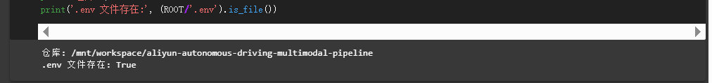

### Step 2 · 参数与环境检查

**可调参数（在** `.env` **中设置）**：

环境检查中的 `configured` 只表示参数非空，不代表认证成功；Step 4 才验证真实连接。

[Notebook 01 - Step 2](notebooks/01_multimodal_data_processing.ipynb#step-2--参数与环境检查)

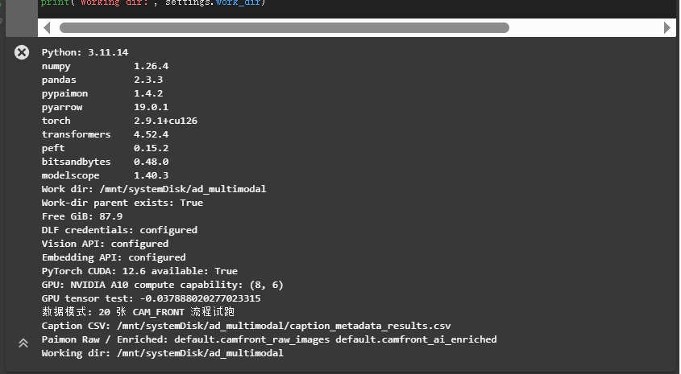

### Step 3 · 获取 nuScenes mini，按配置选择 CAM\_FRONT 帧

下载完整 mini 后按配置选择图片；本地已备好数据时可跳过下载。

#### Step 3.1 · 下载完整 mini 数据集（下一个 Code Cell）

**可调参数**：`RUN_DOWNLOAD=True` 下载并解压，`False` 跳过整个下载/解压步骤；`URL` 是 mini 压缩包地址；`.env` 中的 `WORK_DIR` 决定压缩包和解压目录。压缩包已存在时跳过下载，但仍会解压。两种数据模式都下载完整 mini

[Notebook 01 - Step 3.1](notebooks/01_multimodal_data_processing.ipynb#step-31--下载完整-mini-数据集下一个-code-cell)

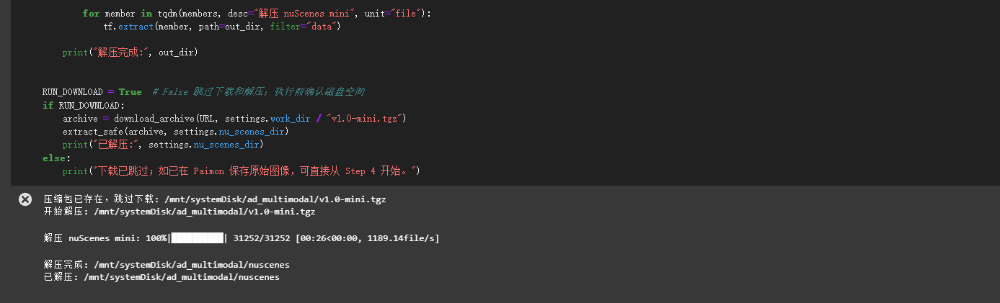

#### Step 3.2 · 选择全量 mini 或 20 张连续 CAM\_FRONT 图片

**可调参数**：`.env` 中 `USE_FULL_MINI=false`（默认）时，优先从 sweeps、其次从 samples 选择同日志连续 20 张图；`true` 时合并 samples 和 sweeps 的全部 CAM\_FRONT 图片，按文件名去重。全量模式使用 `_full_mini` 后缀表及独立标注 CSV。

全量模式后续生成 Caption 和Embedding 的费用更高而且需要等的时间比较长，我额度有限先走小批量跑通流程，后面等额度刷新了再跑全量的。

[Notebook 01 - Step 3.2](notebooks/01_multimodal_data_processing.ipynb#step-32--选择全量-mini-或-20-张连续-cam_front-图片)

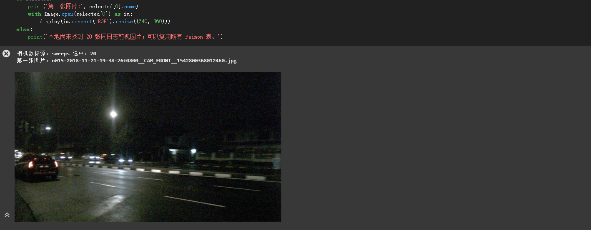

### Step 4 · DSW 连接 DLF 2.0 REST Catalog / Paimon

[Notebook 01 - Step 4](notebooks/01_multimodal_data_processing.ipynb#step-4--dsw-连接-dlf-20-rest-catalog--paimon)

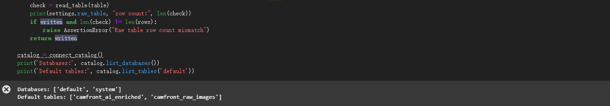

数据湖连接正常，一个原始图像表，一个增强表

### Step 5 · 写入原始 Paimon 表并回读图片

原始表包含 `fileName` 和 `picture`；已有数据与当前选图一致时跳过 Append，避免重复。

**可调参数**：`RUN_RAW_WRITE=True` 写入 Step 3 选中的图片，`False` 跳过写入并读取已有表；`.env` 中 `PAIMON_RAW_TABLE` 指定表名，数据范围由 `USE_FULL_MINI` 决定。已有表文件名不匹配时会报错，不会自动覆盖

[Notebook 01 - Step 5](notebooks/01_multimodal_data_processing.ipynb#step-5--写入原始-paimon-表并回读图片)

### Step 6 · 调用视觉 LLM 生成 Caption 和 Metadata

一次 `responses.create` 调用生成 Caption / metadata，Caption  CSV 按文件名断点续跑。

[Notebook 01 - Step 6](notebooks/01_multimodal_data_processing.ipynb#step-6--调用视觉-llm-生成-caption-和-metadata)

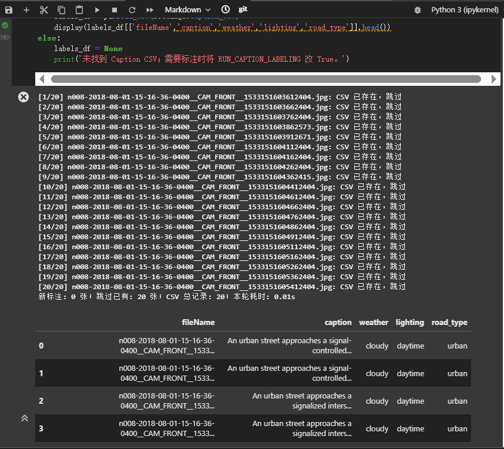

### Step 7 · 创建多模态增强表并写入

`camfront_ai_enriched` 包含图片、GPT Caption、Metadata、`vector` 字段和 `dataset_tag=1`。这是**无主键的 Parquet Append 表**，只在空表时写入。这里其实还差embedding vector还没写进入。

**可调参数**：`RUN_CREATE_ENRICHED=True` 将原始图片与 CSV 标注合并并写入增强表，`False` 跳过创建/写入并读取已有表；`.env` 中 `PAIMON_ENRICHED_TABLE` 指定表名。CSV 文件名集合必须与原始表完全一致；已有增强表也会校验文件名集合，不匹配时报错

[Notebook 01 - Step 7](notebooks/01_multimodal_data_processing.ipynb#step-7--创建多模态增强表并写入)

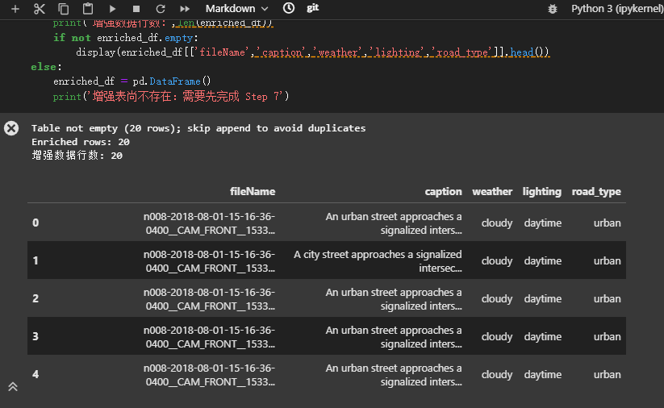

### Step 8 · 生成 1152 维图像/文本 Embedding

使用百炼 DashScope 原生多模态接口，**不是 OpenAI embeddings 接口**；图像和文本分别编码但可做跨模态比较。按内容哈希缓存减少重复调用。

**可调参数**：`RUN_SAMPLE_EMBEDDING=True` 对增强表第一张图片生成或读取缓存向量，`False` 跳过单图验证；

[Notebook 01 - Step 8](notebooks/01_multimodal_data_processing.ipynb#step-8--生成-1152-维图像文本-embedding)

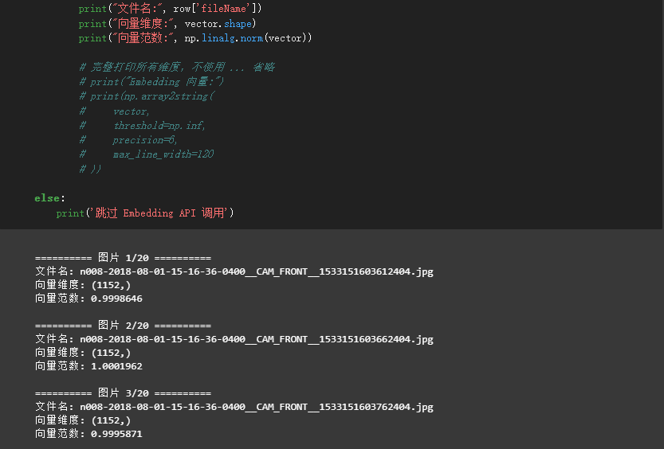

每张图1152维的embedding向量

### Step 9 · embedding回填 Paimon 向量字段

无主键 Append 表不支持通过追加同 ID 行来更新。先将**整表备份为 Parquet**，计算向量，再明确 Overwrite，最后重新读取校验。期间不要并发写入。

**可调参数**：`RUN_VECTOR_BACKFILL=True` 执行批量向量回填，`False` 跳过；调用参数 `confirm_overwrite=True` 明确允许覆盖，设为 `False` 会在需要覆盖时中止。备份保存在 `.env` 的 `WORK_DIR/backups`。执行顺序为备份、生成向量、Overwrite、回读校验；已有完整向量时会跳过。

[Notebook 01 - Step 9](notebooks/01_multimodal_data_processing.ipynb#step-9--安全回填-paimon-向量字段)

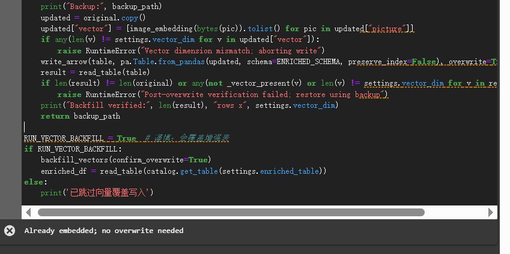

把embedding回填到Paimon表里面，至此，enrichment table就完成了

### Step 10 · 以图搜图 / 以文搜图：余弦 Top-5

NumPy 进行精确余弦相似度检索，未使用 Milvus/ANN，这个就是；文本查询在缓存未命中时调用百炼 Embedding，会产生 API 调用费用。

#### Step 10.1 · 以图搜图（下一个 Code Cell）

**可调参数**：`q = vectors[0]` 中的索引选择查询图片；更换索引时同步修改 `exclude_index=0`，以排除查询图片自身。`cosine_topk(..., k=5)` 的 `k` 控制返回数量。此步骤使用已有图像向量，不调用 API、不改写 Paimon。

[Notebook 01 - Step 10.1](notebooks/01_multimodal_data_processing.ipynb#step-101--以图搜图下一个-code-cell)

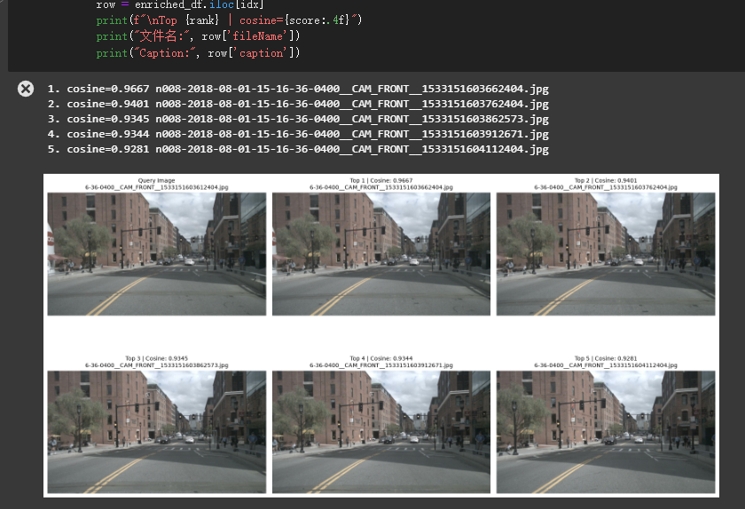

#### Step 10.2 · 以文搜图：自然语言查询 Top-5

**可调参数**：`RUN_TEXT_RETRIEVAL=True` 执行文本检索，`False` 跳过；`query` 设置自然语言查询内容，`cosine_topk(..., k=5)` 的 `k` 控制返回数量。使用 Step 8 的 Embedding 配置和 Step 9 的图像向量；文本向量也调用的是Tongyi的vision模型，输出维度也是1152，这样才能在同维语义空间通过余弦比较相似

[Notebook 01 - Step 10.2](notebooks/01_multimodal_data_processing.ipynb#step-102--以文搜图自然语言查询-top-5)

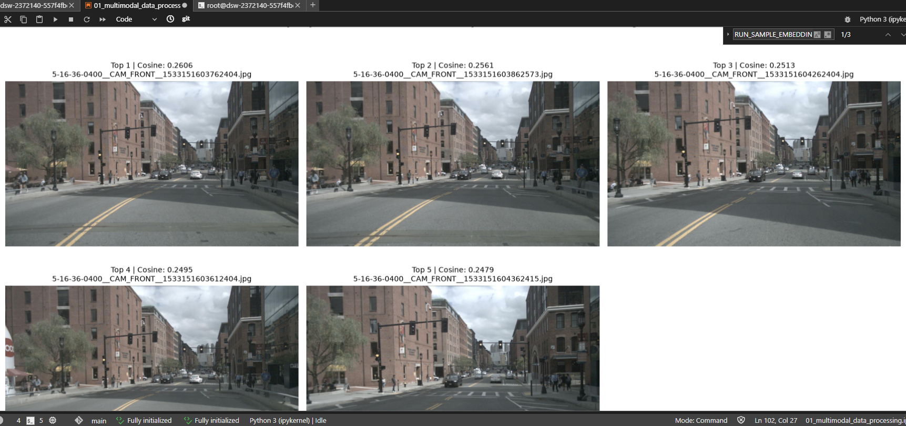

文搜图的相似性挺低的

### Part 1 总结与下一步

- 已验证处理链路：nuScenes CAM\_FRONT → Paimon 原始表 → GPT Caption/Metadata → 增强 Paimon 表 → Tongyi 1152-d Embedding → Top-5 检索。
- Notebook 02 可以直接读取 Paimon 增强表；如果已有 `vlm_training/train.jsonl`，则优先复用它，保持之前的验证样本与基线预测不变。
- **本 Notebook 的全部函数在本文件中定义**，没有 `from multimodal_data_processing import ...`。

## 4. Part 2：Multimodal Model Training & Inference Pipeline

[打开完整 Notebook 02](notebooks/02_multimodal_model_training_inference.ipynb)

| Step | 任务 | 中间产物 |
|---|---|---|
| 0–2 | `.env` / CUDA 检查，复用 JSONL，或者从增强 Paimon 表导出并固定 19/1 划分 | `train.jsonl`, `validation.jsonl`, `split_manifest.json` |
| 3 | 预览图片与 Caption，统计训练集长度 | 图片、Caption 分布 |
| 4 | ModelScope 下载/缓存 `Qwen/Qwen2-VL-2B-Instruct`，NF4 量化加载 | Processor、模型、显存 |
| 5 | 以固定 Prompt 跑 Base Qwen2-VL | `baseline_prediction.json` |
| 6–8 | 插入 LoRA、构建 `labels=-100`、可选 Forward/Backward 测试 | 可训练参数、有效 Token 数、Loss 和梯度 |
| 9 | 19 张图、1 Epoch、梯度累积 4，保存 Adapter | `qwen2vl_lora/`, Loss |
| 10 | 同图片、同 Prompt、同生成参数进行微调后推理 | `inference_comparison.json` |

**Prompt / 图片 / 解码配置必须保持一致**，才能公平比较 Base 与 LoRA；`prepare_model_for_kbit_training` 后不可重复对同一模型调用 `get_peft_model`。

### Step 0 · 环境准备 / Restart Kernel

安装依赖并配置仓库根目录的 `.env`，然后重启 Notebook Kernel。本教程使用 A10 24GB、NF4 + FP16 和 eager attention，沿用 `constraints-cu126.txt` 中的 PyTorch 版本约束。

[Notebook 02 - Step 0](notebooks/02_multimodal_model_training_inference.ipynb#step-0--环境准备--restart-kernel)

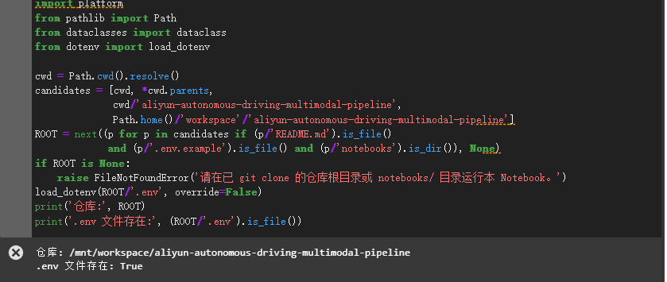

### Step 1 · 加载 `.env` 并检查 A10 GPU

加载配置并检查 Python、依赖版本、CUDA、GPU 型号及计算能力，通过 GPU 张量运算确认环境可用。配置显示 `configured` 仅表示变量非空，不代表云端认证成功。

[Notebook 02 - Step 1](notebooks/02_multimodal_model_training_inference.ipynb#step-1--加载-env-并检查-a10-gpu)

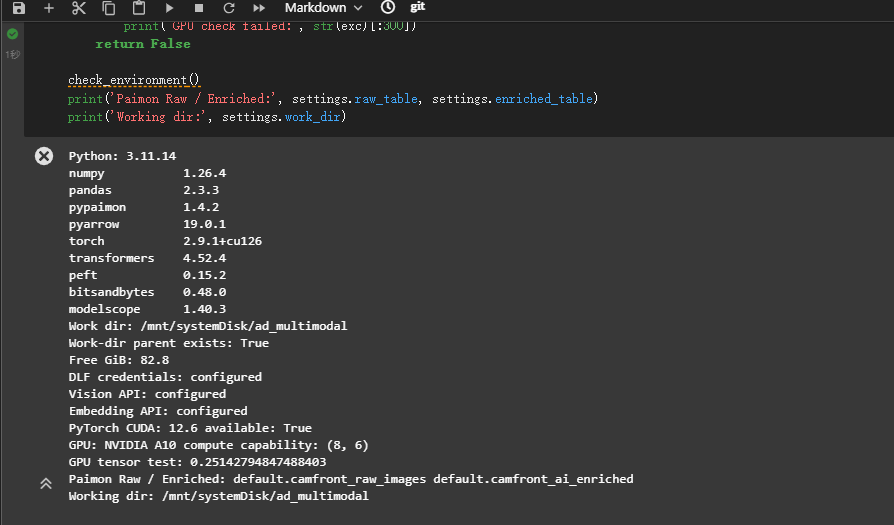

### Step 2 · 从本地 JSONL 复用 19/1 划分，或从 Paimon 重新导出

优先复用已有的 `train.jsonl`、`validation.jsonl` 和划分记录；首次准备数据时再开启 `RUN_EXPORT_FROM_PAIMON=True`。保持验证图片不变，避免重新划分后无法公平比较微调前后的输出。

[Notebook 02 - Step 2](notebooks/02_multimodal_model_training_inference.ipynb#step-2--从本地-jsonl-复用-191-划分或从-paimon-重新导出)

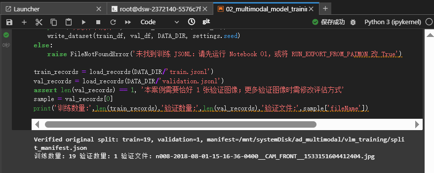

### Step 3 · 可视化样本、Caption 统计与数据集分布

预览图片与 Caption，检查样本数量及 Caption 长度分布。主要用于训练前的数据检查，例如观察描述是否普遍过长、过短，或者有没有长度明显异常的样本。

[Notebook 02 - Step 3](notebooks/02_multimodal_model_training_inference.ipynb#step-3--可视化样本caption-统计与数据集分布)

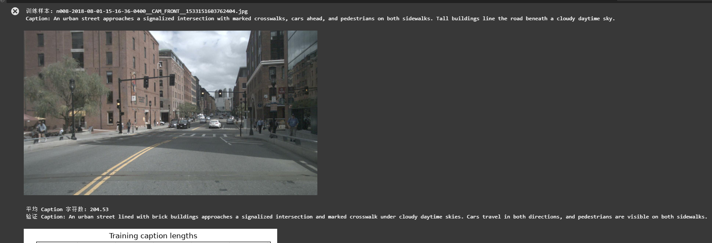

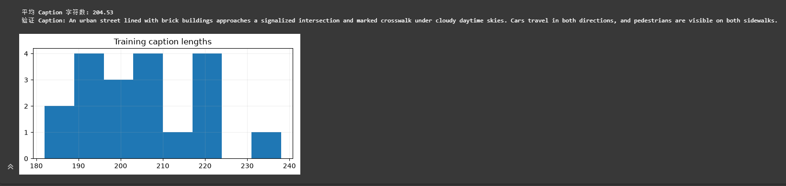

### Step 4 · ModelScope 模型缓存与 NF4/FP16 量化加载

首次的话会从ModelScope魔搭社区下载`Qwen/Qwen2-VL-2B-Instruct`并缓存到本地，之后运行会复用。以 4-bit NF4 存储权重、FP16 计算。加载后保留当前 Kernel 中的 `model` 与 `processor`，供后续推理和训练使用。

- `AutoProcessor`：负责准备模型的输入数据。
- `BitsAndBytesConfig`：负责定义权重量化策略。
- `Qwen2VLForConditionalGeneration`：负责构建模型、加载权重，并按量化配置部署到 GPU。

```python
    # Qwen2-VL 按每个视觉 Token 约 28×28 像素设置图像缩放范围，限制显存开销。
    # Processor 从本地模型目录加载配套的多模态处理器，包括分词器和图像预处理配置。
    # 最后会作为input给到model去generate
    processor = AutoProcessor.from_pretrained(
        path,
        min_pixels=min(128, tokens) * 28 * 28,
        max_pixels=tokens * 28 * 28,
        use_fast=False,
        local_files_only=True,
    )
```

**processor预处理配置参数：**

- `path`：从这个目录加载模型配套的处理器配置、分词器等文件。
- `min_pixels / max_pixels`：设置图像预处理时的最小、最大像素面积，也就是大致约束图片的“宽 × 高”，一个token能描述28*28像素，tokens越大图片分辨率越高，相应地会需要更多的显存。
- `use_fast=False`：选择非 fast 的处理器实现；是否支持 fast，要看 Transformers 版本和对应处理器实现。
- `local_files_only=True`：这次加载只读取本地文件

```python
    # 以 4-bit NF4 量化支持的权重，计算时使用 FP16；双重量化进一步压缩量化参数。
    quantization = BitsAndBytesConfig(
        load_in_4bit=True,
        bnb_4bit_quant_type="nf4",
        bnb_4bit_compute_dtype=torch.float16,
        bnb_4bit_use_double_quant=True,
    )
```

**quantization创建4-bit量化配置**

- `load_in_4bit=True`：开启 4-bit 权重量化加载
- `bnb_4bit_quant_type="nf4"`：指定这 4 bit 怎样表示权重权重，以 4-bit 编码存储
- `bnb_4bit_compute_dtype=torch.float16`：指定量化层的计算类型，需要运算时，底层根据量化编码和缩放信息反量化权重，并按配置的 FP16 计算类型使用它们。
-  `bnb_4bit_use_double_quant=True`：再压缩量化信息。第一次量化除了保存权重编码，还需要保存每块权重的缩放系数等信息。

  开启二次量化后，这些缩放信息本身也会被进一步量化压缩，从而再节省一些显存。

```python
    # 将整个模型放到第 0 张 GPU；非量化浮点部分使用 FP16，Attention 沿用 eager 实现。
    model = Qwen2VLForConditionalGeneration.from_pretrained(
        path, quantization_config=quantization,
        torch_dtype=torch.float16, device_map={"": 0},
        attn_implementation="eager", local_files_only=True,
    )
```

**model 加载基础模型，并放到第 0 张 GPU**

- `path`：从指定的模型目录读取配置和预训练权重。
- `quantization_config=quantization`：使用前面定义的 NF4 4-bit 量化配置加载支持量化的层。
- `torch_dtype=torch.float16`：未量化的浮点部分使用 FP16；量化层的计算类型由前面的量化配置指定。
- `device_map={"": 0}`：把整个模型分配到第 0 张 GPU，也就是A10。
- `attn_implementation="eager"`：使用 eager Attention 实现。
- `local_files_only=True`：仅从本地加载，不在这一步联网下载。

[Notebook 02 - Step 4](notebooks/02_multimodal_model_training_inference.ipynb#step-4--modelscope-模型缓存与-nf4fp16-量化加载)

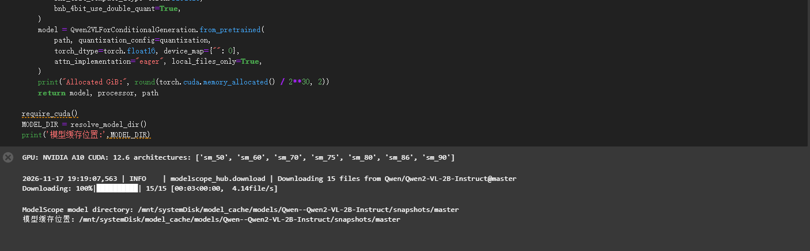

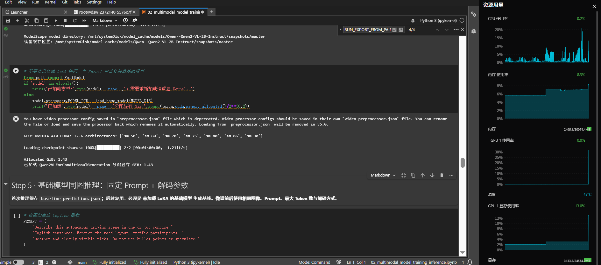

### Step 5 · 基础模型同图推理：固定 Prompt + 解码参数

使用未加载 LoRA 的基础模型生成基线，保存为 `baseline_prediction.json`。记录验证图片、Prompt 和生成参数，后续微调推理使用相同配置。

先装填processor需要的对话模板，主要是将提示词塞进去，然后把图片和文本通过列表的形式转换为PyTorch的张量类型，移到GPU

```python
    # 按模型的对话模板组织文本，并添加供模型续写回答的起始标记。
    prompt_text = processor.apply_chat_template(messages, tokenize=False, add_generation_prompt=True)
    # 将文字和图片转换为模型输入张量，并移到 GPU。
    inputs = processor(text=[prompt_text], images=[image], return_tensors="pt").to("cuda")
    # 切换到评估模式，并关闭梯度记录；这里只推理，不更新权重。
    model.eval()
    # 关闭梯度追踪
    with torch.inference_mode(): 
        # 不进行随机采样，按当前生成配置生成最多 max_new_tokens 个文本 Token。
        ids = model.generate(**inputs, max_new_tokens=max_new_tokens, do_sample=False)
    # Decoder-only 生成式架构，其返回序列包含输入前缀；切掉前缀，只解码新生成的回答。
    new_ids = ids[:, inputs["input_ids"].shape[1]:]
```

eval模式主要控制 Dropout、BatchNorm 等层的工作方式，

inference_mode使用推理模式，不会进行梯度更新

这里用的是Qwen2-VL Instruct，它的语言模型是自回归Decoder-only ，所以输出的结果包含输入和输出，所以需要把结果包含的输入内容（这里面包括input里面的，像image和文本信息）截断。

自指的是模型自己之前生成的结果，也成为后续预测的依据

[Notebook 02 - Step 5](notebooks/02_multimodal_model_training_inference.ipynb#step-5--基础模型同图推理固定-prompt--解码参数)

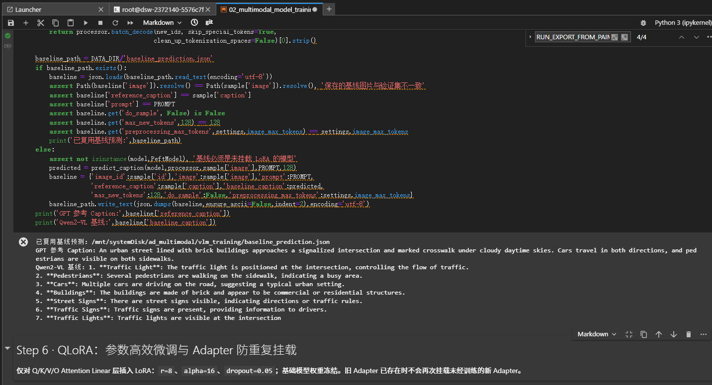

### Step 6 · QLoRA：参数高效微调与 Adapter 防重复挂载

LoRA 的思路是：基础模型的大部分参数保持不变，只训练少量新增参数。这个LoRA理解成一个adapter，外挂在基模的后面。

需要import这些模块

```python
    from peft import PeftModel, LoraConfig, get_peft_model, prepare_model_for_kbit_training
```

[Notebook 02 - Step 6](notebooks/02_multimodal_model_training_inference.ipynb#step-6--qlora参数高效微调与-adapter-防重复挂载)

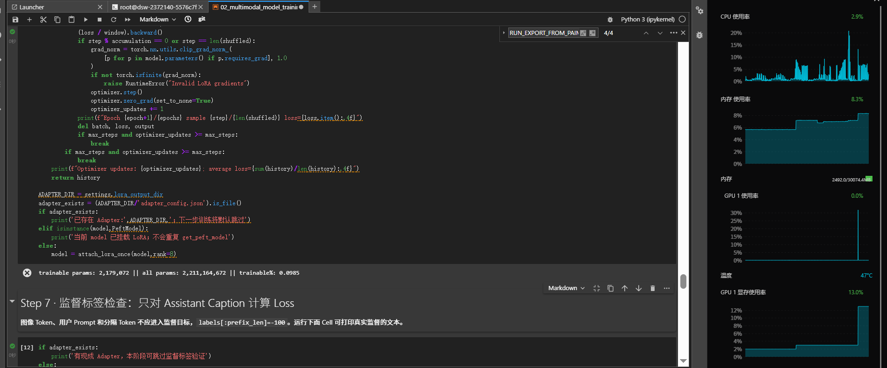

LoRA文件夹里面包含：

`adapter_model.safetensors`：保存训练得到的 A、B 矩阵等权重。

`adapter_config.json`：保存 `r`、`lora_alpha`、目标层等配置，加载时据此重新计算缩放系数。

默认普通 LoRA 的缩放系数为：lora_alpha / r，这保存在adapter_config.json里面；

```python
    # 冻结基础权重并准备量化模型训练；梯度检查点以额外计算换取更少的激活显存。
    base_model = prepare_model_for_kbit_training(base_model, use_gradient_checkpointing=True)
    # 训练时关闭生成用的 KV 缓存，配合梯度检查点使用。
    base_model.config.use_cache = False

```

PEFT 库提供的辅助函数，冻结基模权重，准备低比特模型微调

- 冻结现有的基础模型参数
- 调整部分非量化参数的精度
- use_gradient_checkpointing=True 
  - 在 Forward 时少保存一些中间激活值，等到 Backward 时再重新计算
- Gradient Checkpointing 主要针对训练阶段需要反向传播、保存激活值的特点，用重计算降低显存；
- KV Cache 主要针对自回归推理阶段反复使用历史 Token 的特点，通过缓存历史 K、V 减少重复计算，提高推理效率。
- 所以这两种通常配合使用，训练阶段使用梯度检查点，用增加计算量的代价来降低显存消耗；推理阶段用缓存KV的代价来提高推理效率

```python
def train(records: list[dict], model, processor, *, epochs: int = 1,
          accumulation: int = 4, learning_rate: float = 1e-4, seed: int = 20260520,
          max_steps: int = 0) -> list[float]:
```

- `train_records`：训练样本列表，本次小样本流程是 19 张图片及其 Caption。
- `model`：已经挂载 LoRA 的模型。
- `processor`：模型配套的文本和图像处理器。
- `epochs=1`：训练集遍历一轮。
- `accumulation=4`：每处理一个样本累积梯度，通常每 4 个样本更新一次参数；最后不足 4 个的剩余样本也会触发一次更新。
- `learning_rate=1e-4`：学习率。
- `seed=settings.seed`：使用配置中的随机种子。
- 没有传 `max_steps`，因此采用默认值 `0`，不额外限制优化器更新次数。


### Step 7 · 监督标签检查：只对 Assistant Caption 计算 Loss

检查实际参与监督的文本。图像 Token、用户 Prompt 和分隔 Token 不应进入监督目标，前缀标签通过 `labels[:prefix_len]=-100` 屏蔽，仅对 Assistant Caption 计算 Loss。

[Notebook 02 - Step 7](notebooks/02_multimodal_model_training_inference.ipynb#step-7--监督标签检查只对-assistant-caption-计算-loss)

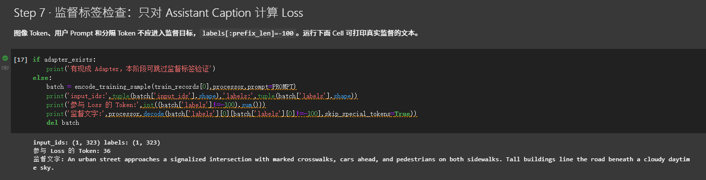

### Step 8 · 单样本 Forward / Loss / Backward（不更新权重）

按需开启 `RUN_GRADIENT_SMOKE_TEST`，用单样本检查 Loss 和 LoRA 梯度是否有限、是否存在非零梯度。这一步不执行 `optimizer.step()`，不进行权重更新。

[Notebook 02 - Step 8](notebooks/02_multimodal_model_training_inference.ipynb#step-8--单样本-forward--loss--backward不更新权重)

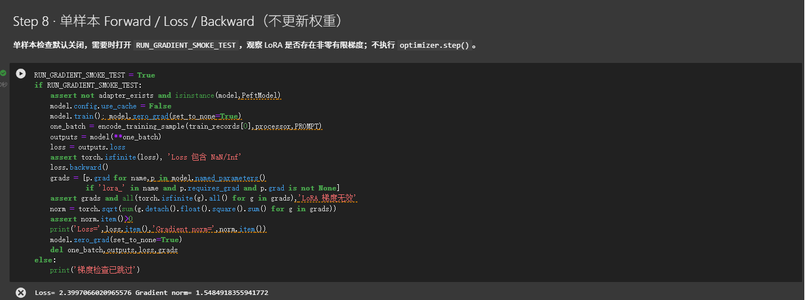

### Step 9 · 使用 19 张图片执行 QLoRA，并保存 Adapter

确认 GPU 费用后，手动设置 `RUN_TRAINING=True`。试跑配置为 19 张图片、1 Epoch、梯度累积 4，约 5 次优化器更新；训练后保存 Adapter。已有 `adapter_config.json` 时禁止覆盖。

[Notebook 02 - Step 9](notebooks/02_multimodal_model_training_inference.ipynb#step-9--使用-19-张图片执行-qlora并保存-adapter)

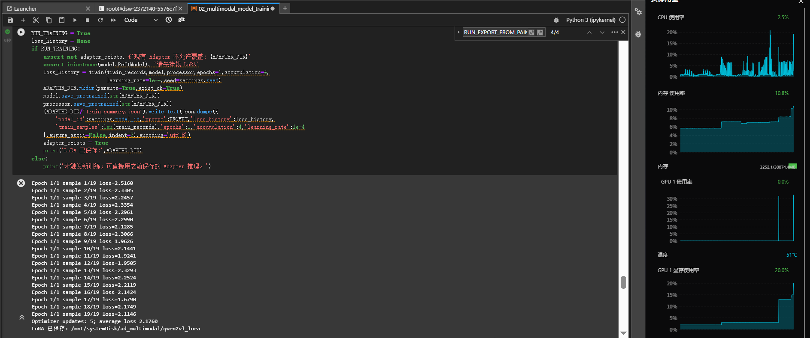

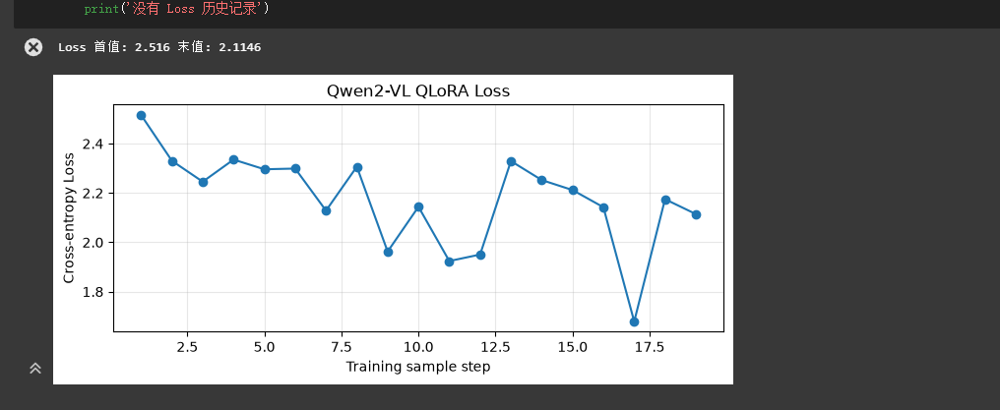

### Step 10 · 同图、同 Prompt 微调后推理与结果对比

保存 LoRA Adapter 后，使用相同图片、Prompt 和生成参数执行微调后推理，保存 `inference_comparison.json`。对照参考 Caption、Base 和 LoRA 输出，记录具体变化；小样本同图对比不能证明新场景泛化能力提升。

[Notebook 02 - Step 10](notebooks/02_multimodal_model_training_inference.ipynb#step-10--同图同-prompt-微调后推理与结果对比)

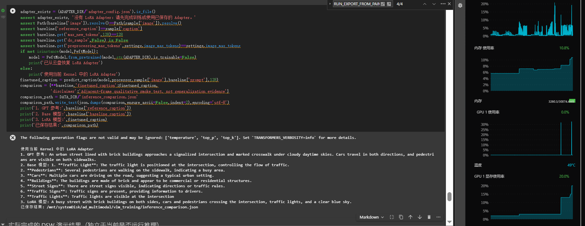

## 5. 实测结果与评价边界

| 项目 | 本次 DSW 实验 |
|---|---|
| 图片 | 20 张 nuScenes CAM_FRONT 相似连续帧 |
| 划分 | 19 张训练 / 1 张验证 |
| Embedding | tongyi-embedding-vision-plus；1152 维 |
| 基础模型 | Qwen2-VL-2B-Instruct |
| 训练 | A10 24GB；4-bit NF4 + FP16；QLoRA `r=8`, `alpha=16` |
| 可训练参数 | 2,179,072（约 0.0985%） |
| 训练配置 | 1 Epoch，梯度累积 4，`1e-4` 学习率 |

**GPT 参考 Caption**：

> A city street approaches a signalized intersection with marked crosswalks, cars ahead, and pedestrians on both sidewalks. Multi-story brick buildings line the road under a cloudy daytime sky.

**微调前**：输出了建筑、车辆、行人、交通灯、天气等 7 条列表，最后因 `max_new_tokens=128` 被截断。

**微调后**：

> A busy urban street with brick buildings on both sides, traffic lights, pedestrians, and vehicles, with a cloudy sky overhead.

这证明实际的**工程数据链路 / QLoRA 风格适配**已在 DSW 走通，但相似连续帧的 19/1 验证**无法证明**跨夜间、雨天或不同道路的泛化提升。

## 6. 常见错误与排查

- **找不到变量、模型或 Processor**：Kernel 重启会清空内存；从 Notebook Step 1 顺序运行，或复用已经保存的 JSONL、模型缓存和 Adapter。
- `NOT configured`：检查 `.env` 文件是否放在仓库根目录，以及变量名是否与 [.env.example](.env.example) 一致。Notebook 仅确认配置非空；DLF 真正的网络/权限验证在 Notebook 01 Step 4。
- **DLF AccessDenied / Trusted VPC / DatabaseNoPermission**：检查 REST API 开通、Warehouse、OSS 与 RAM 授权、DSW 网络环境。
- **LoRA 重复挂载**：不要在已挂 Adapter 的模型上重复调用 `get_peft_model()`；重启 Kernel 后重新加载基础模型和 Adapter。

## 7. 安全、成本、测试与参考资料

官方参考：[阿里云 PAI](https://help.aliyun.com/zh/pai/) · [阿里云 DLF](https://help.aliyun.com/zh/dlf/) · [nuScenes](https://www.nuscenes.org/) · [ModelScope Qwen2-VL](https://modelscope.cn/models/Qwen/Qwen2-VL-2B-Instruct) · [Hugging Face bitsandbytes](https://huggingface.co/docs/transformers/quantization/bitsandbytes)

> 许可注意：仓库没有附带 nuScenes 图片或预训练模型；相关数据与模型需遵循其原许可。仓库尚未额外指定源码许可证。

**成本与数据安全补充**：`USE_FULL_MINI=true` 会扩大 Caption 和 Embedding API 调用量；执行前需确认额度、速率、云盘空间。Notebook 01 Step 9 采用备份后 Overwrite 的实验表向量回填策略，不要对生产表直接执行。

**内容范围**：Notion 当前正文详细记录到 Part 1 Step 10；Part 2、实测结果与常见问题沿用本仓库原 README 的已有说明。Notion 配图已保存至仓库的 images/ 目录。
